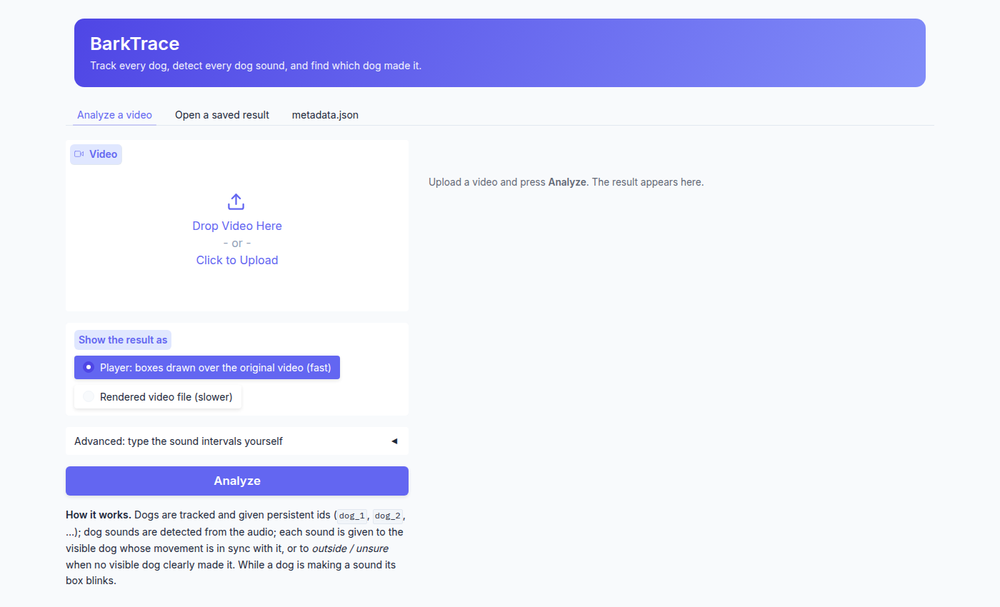
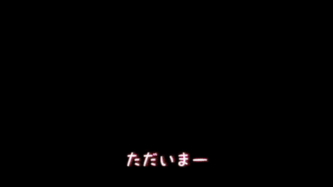
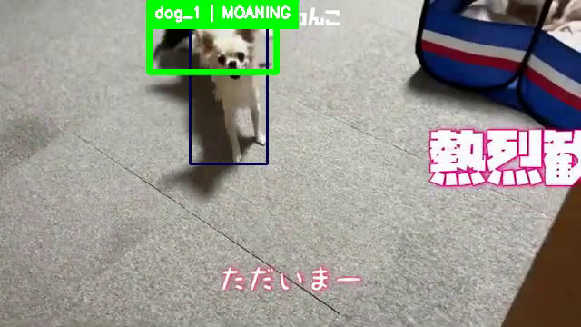
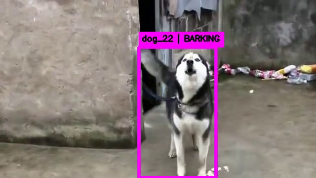

# Audio-Visual Attribution of Dog Vocalizations in Real-World Videos
**BarkTrace** is an audio-visual AI pipeline built with **PyTorch** that answers, for every dog sound in a video,
**which dog made it**.

It **detects every dog vocalization** and labels its type, **tracks each dog with a persistent ID**, and attributes each
sound to the visible dog that made it, or to a dog **off screen**.

The pipeline is **precision first**: naming the wrong dog counts as worse than answering "outside". This repository
holds the pipeline of the master's thesis *BarkTrace: Audio-Visual Attribution of Dog Vocalizations in Real-World
Videos*. The code that trained the fine-tuned models and the evaluation scripts are not part of this release.

---

## Project Features

1. **Dog Sound Detection** – Finds every dog vocalization with a noise-robust BEATs model combined with FlexSED.
2. **Sound Types** – Labels each sound as bark, growl, grunt, howl, moan, pant or whine.
3. **Persistent Dog IDs** – Tracks dogs with LVMT; a conservative identity merger keeps one `dog_id` per dog, even
   after it leaves and re-enters the frame.
4. **Barker Attribution** – A dog fine-tuned Synchformer scores audio-visual sync per bark; the best dog is named only
   above a cut-off, otherwise the sound is "outside".
5. **Web App and CLI** – Gradio web app with an in-browser player, a command-line tool and a batch runner.
6. **Reusable Results** – Every run writes `metadata.json` and Praat files; the annotated video can be rebuilt from
   `metadata.json` and the original video alone.

---

## Project Structure
```
barktrace/
├── app.py                       # Gradio web app (player, saved-result viewer)
├── run_video.py                 # Command line: one video
├── run_batch.py                 # Command line: every video in a folder
├── pipeline.py                  # Runs both branches, plans the GPUs, writes the results
│
├── audio/
│   ├── vocalization_detector.py # Stage 0: dog sound detection (BEATs x FlexSED)
│   └── sound_models/
│       ├── beats_crnn.py        # Lab BEATs sound-event-detection model
│       ├── flexsed.py           # FlexSED with dog prompts
│       ├── finelap.py           # FineLAP frame embeddings
│       ├── pretrained_sed.py    # ATST-Frame (AudioSet-Strong)
│       └── sound_types.py       # Sound-type classifier
│
└── visual/
    ├── dog_tracker_lvmt.py      # Stage 1a: dog detection and tracking (LVMT)
    ├── identity_merger.py       # Stage 2: persistent dog IDs
    ├── appearance_extractor.py  # Box embeddings used by the merger
    ├── appearance_backends.py   # DINOv3 / OSNet embedding backends
    ├── real_dog_check.py        # Stage 2b: removes non-dogs (SigLIP 2)
    ├── barker_attribution.py    # Stage 1b: which dog made each sound (Synchformer + motion)
    ├── model_worker.py          # Keeps the visual models loaded between app runs
    ├── metadata_writer.py       # metadata.json
    ├── praat_export.py          # Praat TextGrid / Table
    ├── video_renderer.py        # Annotated video
    └── web_player.py            # In-browser player

assets/
└── examples/                    # 5 example videos (chihuahua, labrador, shiba inu, husky, pitbull)
    └── <id>_<breed>/
        ├── <video>.mp4
        ├── timestamps.txt       # Labelled bark intervals (start,end)
        └── metadata.json        # A saved result (opens in the app's "Open a saved result" tab)

demo/                            # Screenshots and demo GIF used in this README

third_party/
├── synchformer/                 # Synchformer (MIT), patched for transformers 5
└── lvmt_stubs/                  # Import stubs LVMT needs

setup_third_party.sh             # Clones LVMT, Detectron2, FlexSED, PretrainedSED at the commits used
requirements.txt                 # Exact package versions
```

---

## Models Used

Model weights are not stored in the repository. Put them in `models/`, or point `BARKTRACE_MODELS` at another folder.

| Models | Functions | Path in `models/` |
|---|---|---|
| LVMT (OVIS, DINOv2) | Dog detection and tracking | `lvmt/ovis_dinov2_online_55.6.pth` |
| DINOv3 ViT-B/16 | Identity embeddings | `hf_cache/` |
| SigLIP 2 so400m | Real-dog check | `hf_cache/` |
| Synchformer | Audio-visual sync | `synchformer/24-01-04T16-39-21/` |
| Synchformer dog heads (3 seeds) | Barker attribution | `synchformer/dog_ft_20261026/` |
| Vocalization BEATs, all-dog-sound BEATs | Dog sound detection | `lab_beats_ft/final_vocal_noise.pt`, `final_dog.pt` |
| FlexSED (+ CLAP) | Dog sound detection | `FlexSED/ckpts/flexsed_as.pt`, `hf_cache/` |
| ATST-Frame, FineLAP | Sound-type features | `PretrainedSED/resources/ATST-F_strong_1.pt`, `hf_cache/` |
| Sound-type classifier | Sound types | `dog_sound_types/classifier.joblib` |

- **LVMT**: Download from [Hugging Face](https://huggingface.co/tue-mps/LVMT/resolve/main/Dinov2_online/ovis_dinov2_online_55.6.pth)
- **Synchformer**: Download `24-01-04T16-39-21.pt` and `cfg-24-01-04T16-39-21.yaml` from the [Synchformer](https://github.com/v-iashin/Synchformer) release:
  `https://a3s.fi/swift/v1/AUTH_a235c0f452d648828f745589cde1219a/sync/sync_models/24-01-04T16-39-21/`
- **FlexSED**: Download from [Hugging Face](https://huggingface.co/Higobeatz/FlexSED)
- **ATST-Frame**: Download from the [PretrainedSED releases](https://github.com/fschmid56/PretrainedSED/releases/tag/v0.0.1)
- **Hugging Face models**: `google/siglip2-so400m-patch14-384`, `facebook/dinov3-vitb16-pretrain-lvd1689m` (gated:
  accept its licence first), `laion/clap-htsat-unfused`, `AndreasXi/FineLAP`. Download once with
  `HF_HOME=models/hf_cache`; the pipeline then runs offline.
- **Trained in this work** (dog heads, the two vocalization BEATs, the sound-type classifier): not public.
- **Lab BEATs SED**: the vocalization models are fine-tuned heads of the lab's BEATs sound-event-detection model, which
  is not public either. Put its folder (`beats_work/desed_task`, `hparams.yaml`, `BEATS_iter3_plus_AS2M.pt`,
  `epoch=109-step=6160.ckpt`) in `third_party/beats_sed`, or set `BARKTRACE_BEATS_SED`.

---

## System Architecture
```
video ──┬─ visual branch ── LVMT tracking ── identity merger (persistent dog_id) ── SigLIP 2 real-dog check ──┐
        └─ audio branch  ── vocalization BEATs × FlexSED (threshold 0.80) ── sound type per sound ────────────┤
                                                                                                             │
   barker attribution: each sound is cut into single barks; per bark the dog fine-tuned Synchformer scores   ◄─┘
   every visible dog (+ motion); the best dog is named only above a cut-off, otherwise "outside"
   ── metadata.json, browser player, annotated video, Praat TextGrid
```
- **PyTorch** – All models run on the GPU
- **LVMT + Detectron2** – Video instance segmentation of the dogs
- **DINOv3 + SigLIP 2** – Identity embeddings and the real-dog check
- **BEATs + FlexSED** – Dog sound detection; **ATST-Frame + FineLAP** – sound types
- **Synchformer** – Audio-visual synchrony with a dog fine-tuned "this crop made the sound" head
- **Gradio** – Web app and in-browser player
- **Two GPUs** – The visual and audio branches run at the same time when both GPUs are free

---

## Results

| Stage | Test | Result |
|---|---|---|
| Detection | 45 videos (110 labelled dog sounds, 31 videos without any) | 86.0% precision, 87.9% recall |
| Tracking | 21-video tracking benchmark | 52.6 HOTA, 97.6% identity purity |
| Barker | 297 labelled sounds, held out by YouTube channel | 75.1% right, 2.7% wrong dog |
| End to end | 106 sounds in 14 videos, from the pipeline's own detections | 71.7% right, 0% wrong dog; no dog named in 31 videos without dog sounds |

"Right" means the labelled barker is named, or "outside" when the barker is off screen.

---

## Usage
1. Go into the project directory
   ```bash
   cd BarkTrace-AudioVisualAI-PyTorch
   ```
2. Create the environment (Python 3.12, CUDA 12.6, `ffmpeg` on the `PATH`; results were produced on two 24 GB GPUs,
   one also works)
   ```bash
   conda create -n barktrace python=3.12 && conda activate barktrace
   pip install -r requirements.txt
   ```
3. Clone the third-party code
   ```bash
   ./setup_third_party.sh
   ```
4. Put the model weights in `models/` (see **Models Used**)
5. Start the web app (prints its URL, the first free port from 7860)
   ```bash
   python barktrace/app.py
   ```
6. Or run from the command line
   ```bash
   python barktrace/run_video.py --video assets/examples/723_chihuahua/723_HBntheU9d5I.mp4      # automatic detection
   python barktrace/run_video.py --video assets/examples/723_chihuahua/723_HBntheU9d5I.mp4 \
       --timestamps "$(cat assets/examples/723_chihuahua/timestamps.txt)"                     # typed bark intervals
   python barktrace/run_batch.py --input clips/ --output results/ --render --shard 0/2        # a folder, one shard per GPU
   python barktrace/visual/video_renderer.py <run>/metadata.json                               # rebuild the annotated video
   ```

Each run writes `barktrace/runs/<time>/metadata.json` (dogs and their best pictures, every sound with its type and its
dog, boxes per frame), Praat `.TextGrid` / `.Table` files and `stage_log.txt`. `DOG_PIPELINE_GPU=<n>` forces one GPU
for the command-line tools. With the same weights the pipeline gives the same results on every run.

---

## User Interface
<p align="center">
  
</p>

<p align="center"><i>Web app: upload a video, choose the player or a rendered video, and optionally type the sound intervals</i></p>

---

## Demo
<p align="center">
  
</p>

<p align="center"><i>Chihuahuas barking in bursts: each dog keeps its ID, and the box of the dog that barks flashes</i></p>

<p align="center">
  
  &nbsp;&nbsp;&nbsp;
  
</p>

<p align="center"><i>Annotated frames from the current pipeline</i></p>

---

## Acknowledgements
BarkTrace builds on [LVMT](https://github.com/tue-mps/lvmt), [Detectron2](https://github.com/facebookresearch/detectron2),
[Synchformer](https://github.com/v-iashin/Synchformer), [BEATs](https://github.com/microsoft/unilm/tree/master/beats),
[FlexSED](https://github.com/JHU-LCAP/FlexSED), [PretrainedSED](https://github.com/fschmid56/PretrainedSED), FineLAP,
SigLIP 2 and DINOv3. Each keeps its own licence. The example videos are short YouTube clips, included for
demonstration.
